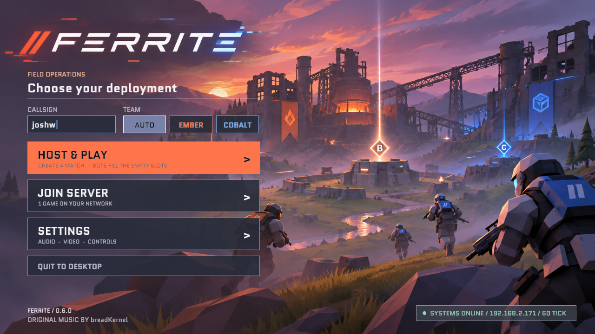

# FERRITE 0.8 (upcoming)




An original low-poly multiplayer FPS in Rust. Two teams of twelve, EMBER and COBALT, fight over five control points strung across a valley. Only the front line can be contested, so the battle has a shape: it masses, breaks, and moves.

v0.3 was a from-scratch rewrite (nothing from the v0.2 prototype is reused; it remains in git history). v0.4 built on it:

- **Movement.** Slide (crouch at a sprint), climb ledges up to head height (hold jump into them), and a touch more weight when starting and stopping.
- **Gunplay.** Recoil climbs and wanders while you hold the trigger and settles when you let go; sustained fire opens the cone, so bursts beat spraying at range. Assists are scored.
- **Bots.** They run from grenades, and the cautious ones fall back when badly hurt instead of fighting to the death.
- **Graphics.** Real sun shadows for the whole valley and everyone in it, light from muzzle flashes and explosions, valley haze, surface grain, grass and pebbles, bullet holes, scorch marks, shell casings, dust.
- **Animation.** Soldiers stride in the direction they move, lean into a run, kneel, tuck for a jump, slide, lower the weapon to sprint or reload, flinch when hit and fall where they die. First person has real arms, a magazine change, a working pump and bolt, and reacts to landing, strafing, sliding and climbing.
- **Sound.** It has some now - v0.3 shipped silent because the audio backend was never switched on. Shots, steps and explosions are placed left or right, enemy footsteps are audible, and near misses crack past your ear.

v0.5 adds a lobby before every round (map vote, loadouts, ready-up countdown), thirteen more guns (sixteen in all) with a loadout panel for class, primary and sidearm, map rotation, and bots that work as a squad.

v0.6 adds a new launcher and lobby look (key art, palette and typeface from the FERRITE UI kit), launcher and lobby music, a pause overlay, 3D models of every gun in the loadout picker, a bot difficulty selector, and a camera that follows whoever eliminated you while you wait to redeploy.

v0.7 adds text chat, a melee strike, a killcam, player icons, callsigns backed by a player id (your record follows you when you rename), a kill feed that puts people ahead of bots, the plumbing for weapon finishes, a Windows installer, and updates from inside the launcher.

## v0.8 (upcoming)

- **Two new maps.** Spillway brings drained waterworks, pump halls and a floodgate; Relay adds a highland communications station, antenna towers and rocky pine flanks. Six maps are now in the rotation. The original four retain their terrain, cover and objectives.
- **New soldier shapes and animation.** All six looks have layered, faceted armor and team-marked field packs based on the launcher artwork, with articulated movement, planted feet and hands that follow the weapon's action.
- **Cleaner guns and sights.** The existing guns have corrected barrels, receivers, magazines and reload actions, shared between first person, soldiers and loadout previews. Iron sights and optics have connected mounts, protected posts and clear, aligned aiming apertures.
- **Six weapon finishes.** Oxide, Arctic, Woodland, Midnight, Hazard and Sandstorm add bands or digital camouflage to every gun. Click the large loadout models or press 7 / 8 to cycle finishes; the choice is saved per weapon and applies at the next deploy.
- **Rendering and finish fixes.** Larger model batches render in full, local corpses keep their weapon finish, and finish changes persist after direct host/join launches. Map voting fits all six choices.

The weapon roster and gameplay statistics are unchanged. See the [full v0.8 release notes](docs/release-notes/v0.8.0.md) for fixes and verification details.


## Download

Windows, Linux and macOS builds of the client and the dedicated server are on the [releases page](../../releases).

- **Windows installer:** `ferrite-vX.Y.Z-windows-x64-setup.exe`. It installs for the current user (no administrator prompt), adds Start menu entries for the game and the dedicated server, and can be removed from *Installed apps*. Windows SmartScreen may warn that it is unrecognised: the build is not code-signed.
- **Portable:** the `.zip` / `.tar.gz` for your system. Unpack anywhere and run `ferrite`.

Either way the game keeps itself current: the launcher checks this repository's releases when it opens and shows **UPDATE & RESTART** when there is a newer one (SETTINGS > VIDEO > CHECK FOR UPDATES turns the check off; `ferrite --update` does it from a terminal). Everyone in a match needs the same release, so update together.

**macOS:** the build is not signed with an Apple Developer ID, so a copy downloaded in a browser is blocked by Gatekeeper. The simplest way round it is to download from Terminal, which does not get flagged:

```sh
curl -L https://github.com/Kalaghni/ferrite/releases/download/v0.7.0/ferrite-v0.7.0-macos-universal.tar.gz | tar xz
./ferrite-v0.7.0-macos-universal/ferrite
```

If you already downloaded it in a browser, run `xattr -dr com.apple.quarantine .` in the unpacked folder once.

## Run from source

Needs stable Rust. No setup - geometry and sound effects are generated in code, and the few assets (launcher and lobby art, the Quantico typeface, the lobby track) are built into the executable.

```sh
cargo run --release -p ferrite
```

The game opens on a home screen. **Host and play** starts a match inside the game (24 fighters, bots fill every empty slot). **Join a server** lists games found on your network - click one to join - and also takes an address and a port (default 27500) and remembers servers you have joined. Click the window to deploy.

Skip the home screen, or run a dedicated server:

```sh
cargo run --release -p ferrite -- --host                      # host straight away
cargo run --release -p ferrite -- --connect 192.168.1.20      # join a host (UDP 27500)
cargo run --release -p ferrite-server                         # dedicated server
cargo run --release -p ferrite-server -- --map depot          # ...on another map
```

Six maps ship with the game. The host picks one on the home screen (or with `--map NAME`); a dedicated server takes `--map quarry`, and `--maps` lists them. Maps rotate each round by default: `--rotation quarry,depot` plays just those, `--rotation off` (or `--no-rotate` when hosting from the client) stays on one. Clients are told the map when they join.

| Map | Character |
|---|---|
| Foundry Valley | The original: rolling valley, ruined foundry in the middle |
| Quarry | A terraced pit; the centre point sits on the pit floor, overlooked from every side |
| Ridgeline | Pine forest split by a rock-crowned ridge with three passes through it |
| Depot | Flat container yard: close quarters and short sightlines |
| Spillway | Drained waterworks: a sunken channel, pump halls, floodgate and outer service lanes |
| Relay | Highland communications station: antenna towers, generator shelters and rocky pine flanks |

Spillway and Relay extend the rotation; the original four maps retain their terrain, cover and objective layouts. All six share the five-point front line and mirrored routes for both teams.

Each human replaces a bot. Pick EMBER, COBALT or AUTO on the home screen (AUTO joins the side with fewer humans), and press M in a match to change sides: you trade places with a bot, so the teams stay the same size. Allow UDP 27500 through the host's firewall, and UDP 27499 if you want the game to show up in other players' lists.

| Key | Action | Key | Action |
|---|---|---|---|
| WASD | move | LMB | fire |
| Shift | sprint | RMB | aim down sights |
| Space | jump | R | reload |
| Ctrl / C | crouch (hold) | G | frag grenade |
| Q / F / wheel | swap primary and sidearm | T | change sight |
| L | loadout (1-3 class, 4 / 5 next primary / sidearm) | M | change team |
| Tab | scoreboard | F3 | fps / ping / prediction stats |
| Esc | release mouse | Q | leave match (only while mouse is released) |
| - / = | mouse sensitivity (remembered) | V / middle mouse | melee |
| Enter / Y | chat to everyone | U | chat to your team |

Crouch while sprinting to slide. Hold Space while pushing into a ledge to climb it.

Useful flags: `--name`, `--team ember|cobalt|auto`, `--bots N` (players per team), `--difficulty recruit|regular|veteran|elite` (bots; `--skill 0.6` for a value in between), `--no-music`, `--tickets N`, `--seed N` (different valley), `--fullscreen`, `--volume 0..1`, `--shadows high|low|off`, `--spectate` (watch the bots fight).

## The game

- **Chat.** ENTER (or Y) opens a line to everyone, U to your own side; TAB switches between the two while you type, ENTER sends, ESC cancels. It works in the lobby, in a match, while you wait to redeploy and on the pause overlay. The server keeps messages to 120 characters and one every second and a half (four in a burst), and announces who joins and leaves. In the lobby R is now the ready key.
- **Melee.** V (or the middle mouse button) strikes with the weapon in hand: 75 damage to whoever is within arm's reach in front of you, and a kill outright from behind. It takes about half a second, during which you cannot fire, and it interrupts a reload. It makes no gunshot, so it does not put you on the enemy's minimap. Bots use it when you get close enough.
- **Killcam.** A moment after you go down, the three seconds before it are replayed through the eyes of whoever got you - their weapon, their sight picture, you marked YOU - rebuilt from the snapshots your client already had, so it costs the server nothing. SPACE or a click skips it; then the camera follows them live as before.
- **Callsigns and ids.** On first launch the game makes a random id and keeps it in `ferrite-client.txt`. Servers file your record under that id rather than your callsign, so renaming keeps your kills and someone borrowing your name does not get them. The id is sent to the servers you join and never shown to other players. It is an identity, not a login: there is still no authentication (see below). Records from before v0.7 were kept by name; the first player to come back under that name takes theirs over.
- **Player icons.** A 16 x 16 icon sits beside your callsign in the kill feed, the scoreboard, chat, the lobby and above your head for teammates. Pick one of nine emblems in eight colours on the home screen, or use your own picture: drop a PNG on the launcher window (or leave one beside the game as `icon.png`) and it is cropped square and shrunk to fit. Other players' clients fetch it from the server the first time they see you.
- **Kill feed.** A kill by or of a person is a full-size line with icons that stays eight seconds, and yours are outlined in gold; bots shooting bots are small, dim, and gone in four.
- **Weapon finishes.** Factory plus six finishes fit every existing gun: Oxide, Arctic, Woodland, Midnight, Hazard and Sandstorm. Metal, furniture and small parts use coordinated palettes with bands or digital camouflage. Click the large primary or sidearm model in the loadout panel, or press 7 / 8, to cycle its finish; your choice is remembered separately for each weapon and applies at your next deploy. The server validates it, and the same finish appears in first person, on soldiers, in the killcam and in the loadout preview. Bots use a mix of finishes.
- **One front.** Points A-E must be taken in order from your side. You can only push a point that touches ground you hold, so both teams always know where the fight is - and flanking means going around it, not ignoring it.
- **Numbers matter.** Capture speed scales with how many more of you are on the point (up to 3). Lone wolves stall; squads take ground.
- **Surge.** Capturing a point gives the whole team eight seconds of faster movement and half-time reloads. A capture is the moment to push the next point, not to rest.
- **Waves and rubber band.** Reinforcements arrive in waves, and the more ground a team holds the longer its waves take. Winning stretches you thin; losing teams hit back together.
- **Tickets.** Every death costs one; holding more points bleeds the enemy. First team to zero loses, then the round resets.
- **Crouch.** Half speed, a much smaller target (you fit behind sandbags and crates), and 40% tighter spread. You cannot stand up under something.
- **Slide and climb.** Crouching at a sprint slides you a few metres, low and fast. Holding jump against a ledge within reach climbs it - low walls and crates, not containers.
- **Bursts.** Each shot heats the barrel and widens the cone; it cools in a fraction of a second off the trigger. The crosshair shows the real spread.
- **Sidearms.** Every class carries a handgun: the 12-round pistol, a six-shot revolver, an automatic machine pistol, or a two-shot sawn-off. Drawing it takes a quarter of a second - far quicker than a reload - and you move slightly faster with it out.
- **Sights.** Press T to cycle the sight on the weapon in hand: iron sights, red dot, holo, 2.5x optic, and 4x / 8x scopes on the Longrifle. Each has its own model, reticle and zoom; your choice is remembered per weapon. Protected front posts and clear rear notches improve the iron sights, while red dots, holographic sights and scopes have open sight windows and fitted rail mounts.
- **Launcher.** HOST & PLAY (players per team, map, rotation, bot difficulty), JOIN SERVER (games found on your network, saved servers, or an address), and SETTINGS (sound output device, music on/off, music and effects volume, mouse sensitivity). Choosing an output device works on Windows; Linux and macOS always use the system default. It relies on a small patch to the audio library, kept in `vendor/quad-snd`.
- **Pause overlay.** ESC brings up match control over the live game: resume, loadout, settings (sensitivity, effects and music volume), change team, leave. Beside it are the score, the front line, your squad and the controls.
- **Music.** Songs rotate on the launcher with a NOW PLAYING plate and a skip button; the lobby has its own track. MUSIC IN A MATCH (off by default) keeps the rotation going, quieter, while you play. Your own `.ogg` or `.wav` files in a `music` folder beside the executable join the rotation. To build a song in, add the `.ogg` to `crates/client/assets/` and a line to `SONGS` in `crates/client/src/audio.rs`.
- **Round by round.** The scoreboard (TAB, and at the end of every round) lists the rounds played so far - map, winner, tickets, length and top scorer - with the series score, and shows each player's record on that server next to this round's figures: kills, deaths, and rounds won out of rounds played. A server keeps its players' records in `ferrite-stats.txt` beside the executable (`--stats FILE` or `--stats off` on the dedicated server), so they survive a restart. Records go by callsign.
- **Looks.** Six looks for your soldier (Regular, Scout, Heavy, Ghost, Veteran, Hazard), chosen under the classes on the loadout panel or with 6. They are cosmetic: the team colour stays on the torso. Bots turn out in a mix of them.
- **Max bots.** HOST & PLAY has a MAX BOTS box (`--max-bots N` on the server). Left empty, bots fill every slot; with a limit the remaining seats stay empty until people join, and the bots move to whichever side is short.
- **Bot difficulty.** Recruit, Regular, Veteran or Elite: it scales how fast bots react and how tightly they aim. Chosen when hosting, or with `--difficulty` on the dedicated server.
- **Kill cam.** A moment after you go down the camera follows whoever got you, with their name, health and weapon, until you redeploy.
- **Lobby.** Every round starts in a lobby: vote for the map, choose a loadout, pick a side, and click READY. The countdown is 30 seconds, or three once everyone is ready. An empty dedicated server waits in its lobby for the first player; someone who joins mid-round drops straight in. `--lobby 0` turns it off.
- **Three classes, sixteen guns.** Vanguard (100 HP, two frags): Carbine, Lancer burst rifle, Wasp submachine gun or Bulwark machine gun. Breacher (130 HP, slightly faster): Scattergun, Rattler self-loading shotgun, Slugger slug gun, Drummer automatic shotgun or Wasp. Marksman (90 HP): Longrifle, Ranger self-loading rifle, Hammerhead heavy rifle or Warden battle rifle; anyone its scoped rifles hit is marked through walls for the whole team for six seconds. Pick a class, a primary and a sidearm in the lobby, on the panel that appears while you wait to deploy, or with L at any time. Every row shows a 3D model of the gun, and the two you have chosen turn slowly above the list. The choice applies at your next deploy and is remembered.
- **Map rotation.** After each round the server moves to the next map, unless the lobby votes for another. Hosting from the home screen has a MAP ROTATION switch; a dedicated server rotates through every map unless told otherwise.
- **Readable battlefield.** Team-coloured soldiers and tracers, light pillars over every objective, a front-line bar, minimap that shows enemies who fire or are marked, damage direction indicators.
- **Breakable cover.** Wooden crates shatter under fire and grenades, for everyone, authoritatively.

## Architecture and trade-offs

```
crates/shared   deterministic sim (movement, collision, weapons), map generation, wire protocol
crates/server   game rules, bots, UDP front end; also a library the client embeds to host
crates/client   window, renderer, prediction, effects, synthesised audio, HUD, launcher
```

- **Server authoritative, client predicted.** Clients send only intent (buttons and view angles) at 60 Hz. The server runs the same `sim::step` the client used to predict, so with no loss prediction is bit-exact, and after loss the client replays its unacknowledged commands on top of the next snapshot. Position is never accepted from the network.
- **Trust boundary.** Commands are bounds-checked and sequence-checked, and a per-player budget caps how much simulated time a client can claim (a flood of 600 commands moves you under 3 m, not 80). Fire rate, ammo and hits are all decided server-side. Packet decoding is size-limited and cannot panic.
- **Lag compensation.** Hitscan is resolved against where targets were on the shooter's screen, using a per-player position history, capped at 0.5 s of rewind.
- **Loss tolerance.** Every command rides in three consecutive packets. Kills, captures and round state use an acknowledged feed that is resent until confirmed; tracers and hit sparks are sent once because losing one costs nothing.
- **Snapshots.** 30 Hz, fixed-int bincode, about 550 bytes for 24 players (measured ~16 kB/s per client), under one MTU. Remote players are interpolated 100 ms in the past.
- **Bots are clients.** A bot produces the same command struct as a human and goes through the same validation. They navigate with precomputed flow fields (three lane preferences per objective), follow a shared team push order, and have reaction time and aim error that settles while tracking. They wait for the squad before stepping onto a point, turn toward fire that hits a squadmate, go and look where a target vanished, back off to reload, keep long rifles outside the point, fight at the range their weapon is good at, save grenades for bunched enemies, and hop or climb what is in the way.
- **Rendering.** macroquad provides the window, input, audio and 2D HUD; the 3D scene uses raw miniquad pipelines with one custom shader: flat shading, a single sun shadow map covering the whole valley (depth packed into an RGBA target, so it needs nothing beyond GLSL 100), four short-lived point lights, and fog. Chosen over Bevy for a 15-second rebuild and a small, stable API surface; the cost is no post-processing.
- **Finding games.** Servers, hosted or dedicated, answer a discovery query sent to multicast group 239.255.70.82 on UDP 27499 (and to the broadcast address, for networks that drop multicast) with their name, map, player count and port. The home screen asks about once a second. It is LAN-only by nature; across the Internet or a VPN that does not carry multicast, type the address. `--name` names a dedicated server and `--no-discovery` hides it.
- **Simple by choice.** Axis-aligned collision boxes on a heightfield; no player-player collision (keeps prediction exact); UDP source address is the session identity with no encryption or authentication - LAN/VPN only, not Internet-hardened. A player id is taken on trust: whoever runs a server you join could reuse it elsewhere.
- **Chat, icons and the roster.** Chat lines are numbered and resent with each snapshot until the client acknowledges them; what a client says goes up three times under one id and is said once. Icons are 1 kB each: the server lists who has which (by hash) once a second and a client asks for the ones it lacks. The roster now goes out twelve players to a datagram, so a full 16v16 server no longer relies on IP fragmentation.
- **Updates.** The launcher reads the redirect of this repository's `/releases/latest` to learn the newest tag, and if it is newer downloads that release's archive for the platform over HTTPS, unpacks it, and swaps the files in beside the executable (the running ones are renamed `*.old` and removed at the next start; settings, records and an edited `start-server` script are left alone). It uses the `curl` and `tar` that Windows 10+, macOS and Linux include rather than carrying a TLS stack; without them there is just no update notice. Builds run from a cargo `target` folder never update themselves.

## Verification

```sh
cargo test --workspace                                            # 41 tests across client, server and shared code
cargo run --release -p ferrite-server -- --bench 900              # headless 15-minute bot war + timing
cargo run --release -p ferrite -- --spectate                      # watch a match
cargo run --release -p ferrite -- --auto --quit-at 30             # scripted client, prints session stats
```

The tests cover: prediction equals server state exactly over 900 random commands; replay after delayed delivery converges; command-flood rate limiting; NaN/out-of-range/replayed input and malformed packets; a five-minute 12v12 soak asserting territory stays contiguous, nobody leaves the map or falls through terrain, and snapshots stay under 1400 bytes; a real UDP join / drive / acknowledge / leave round trip; and the newer mechanics - crouch, sidearm, team switching, slide, climbing (a 1.9 m ledge yes, a 3.2 m wall no), spread bloom, assists, loadout validation, map rotation, burst fire, the lobby, and delivery of effects raised between ticks (the bug that used to eat hit markers). New in v0.7: chat reaching only the people it should, in packet-sized pieces; melee reach, facing, the kill from behind and the lock-out while swinging; records following a player id through a rename, a name clash and a server restart; and, over real UDP, the roster arriving in parts, a chat line said three times and heard once, and an icon going up with the hello and coming back on request.

New in v0.8: complete geometry fingerprints for the original maps; seeded navigation and symmetry checks for Spillway and Relay; soldier pose and weapon-action bounds; all seven finish ids, next-deploy application, roster and real UDP replication, and valid bot finishes; paint confined to weapon surfaces; clear optic apertures; and dynamic meshes spanning multiple pages. The discovery test also works while another local game is running.

Scripted-run aids added for these: `--seek` (the scripted player walks to the front line, so it gets shot), `--shot-killcam`, `--say TEXT`, `--icon N`, `--vm-melee 0.75`, and `--update --pretend-version 0.5.0` to exercise the updater against a real release.

To build the Windows installer: `.\packaging\build-installer.ps1` (needs Inno Setup 6: `winget install JRSoftware.InnoSetup`). It writes `dist\ferrite-vX.Y.Z-windows-x64-setup.exe`; the GitHub workflow builds and attaches the same thing on a tagged release.

Every client prints a line on exit with frame times, ping, snapshot count, bandwidth and the number of prediction corrections over 1 cm. `--shot file.png --shot-at SECS` saves a frame.

For deterministic asset review without joining a server or changing saved settings:

```sh
cargo run -p ferrite --example asset_review -- players target/players.png
cargo run -p ferrite --example asset_review -- players target/running.png run
cargo run -p ferrite --example asset_review -- weapons target/weapons.png
cargo run -p ferrite --example asset_review -- skins target/skins.png
cargo run -p ferrite --example asset_review -- sights target/sights.png
cargo run -p ferrite --example asset_review -- spillway target/spillway.png
cargo run -p ferrite --example asset_review -- relay target/relay.png
```

Omit the output path for an animated review window (ESC closes it). Soldier poses also include `crouch`, `slide`, `air`, `reload`, `melee` and `fall`. The six looks use layered, faceted armor and team-marked field packs based on the launcher artwork. First person, loadout previews and soldiers share the existing weapon models; the weapon roster and gameplay stats are unchanged. Geometry checks cover legacy map preservation, new map navigation, soldier pose bounds, weapon actions, finish patterns and clear sight apertures.

Note on the ping readout: acknowledgements ride on 30 Hz snapshots, so loopback shows about 15 ms. It is an upper bound on round trip, not a precise measurement.

License: MIT.

## Credits

- Music by breadKernel: "Liquid Plasma" and "Submariner" (launcher) and "Foundrite Lobby" (lobby).
- Typeface: Quantico by Matthew Desmond, under the SIL Open Font License (`packaging/Quantico-OFL.txt`).
- Launcher and lobby key art, palette and layout: the FERRITE UI kit, "The Frontline".

## Licence

The source code is under the MIT licence (`LICENSE`). The music and artwork in `crates/client/assets/` (and the icon made from it, `packaging/ferrite.ico`) are **not**: they are all rights reserved and may only be used as part of FERRITE. See `crates/client/assets/LICENSE.md`.
