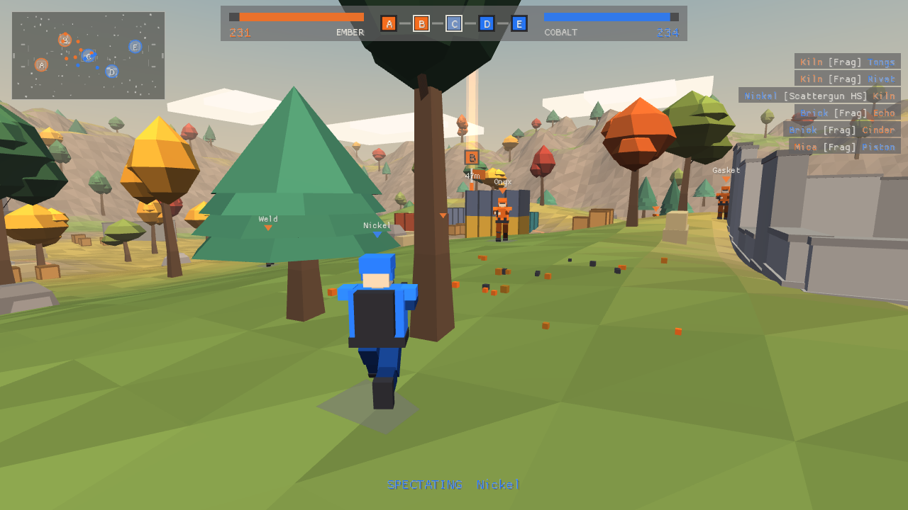

# FERRITE 0.15.3




An original low-poly multiplayer FPS in Rust. Two teams of twelve, EMBER and COBALT, fight over five control points strung across a valley. Only the front line can be contested, so the battle has a shape: it masses, breaks, and moves. That is Conquest; Team Deathmatch, Capture the Flag and Stronghold play faster or slower on the same maps.

What each release added is in the [changelog](CHANGELOG.md).

## Download

Windows, Linux and macOS builds of the client and the dedicated server are on the [releases page](../../releases).

- **Windows installer:** `ferrite-vX.Y.Z-windows-x64-setup.exe`. It installs for the current user (no administrator prompt), adds Start menu entries for the game and the dedicated server, and can be removed from *Installed apps*. Windows SmartScreen may warn that it is unrecognised: the build is not code-signed.
- **Portable:** the `.zip` / `.tar.gz` for your system. Unpack anywhere and run `ferrite`.

Either way the game keeps itself current: the launcher checks this repository's releases when it opens and shows **UPDATE & RESTART** when there is a newer one (SETTINGS > VIDEO > CHECK FOR UPDATES turns the check off; `ferrite --update` does it from a terminal). Everyone in a match needs the same release, so update together.

**macOS:** the build is not signed with an Apple Developer ID, so a copy downloaded in a browser is blocked by Gatekeeper. The simplest way round it is to download from Terminal, which does not get flagged:

```sh
curl -L https://github.com/Kalaghni/ferrite/releases/download/v0.15.3/ferrite-v0.15.3-macos-universal.tar.gz | tar xz
./ferrite-v0.15.3-macos-universal/ferrite
```

If you already downloaded it in a browser, run `xattr -dr com.apple.quarantine .` in the unpacked folder once.

## Run from source

Needs stable Rust. No setup - geometry and sound effects are generated in code, and the few assets (launcher and lobby backgrounds, the Quantico typeface, the lobby track) are built into the executable.

```sh
cargo run --release -p ferrite
```

The game opens on a home screen. **Host and play** starts a match inside the game (24 fighters, bots fill every empty slot). **Join a server** lists the public servers (see [playferrite.com](https://playferrite.com)) and games found on your network - click one to join - and also takes an address and a port (default 27500) and remembers servers you have joined. Click the window to deploy.

Skip the home screen, or run a dedicated server:

```sh
cargo run --release -p ferrite -- --host                      # host straight away
cargo run --release -p ferrite -- --connect 192.168.1.20      # join a host (UDP 27500)
cargo run --release -p ferrite-server                         # dedicated server
cargo run --release -p ferrite-server -- --map depot          # ...on another map
cargo run --release -p ferrite-server -- --mode tdm           # ...or in another mode
```

Seven maps ship with the game, including Slag Cathedral. The host picks one on the home screen (or with `--map NAME`); a dedicated server takes `--map quarry`, and `--maps` lists them. Maps rotate each round by default: `--rotation quarry,depot` plays just those, `--rotation off` (or `--no-rotate` when hosting from the client) stays on one. Clients are told the map when they join.

| Map | Character |
|---|---|
| Foundry Valley | Autumn steelworks, twin-stack boiler workshops and covered service culverts |
| Quarry | A terraced pit with an underground mine, winding headframes and site workshops |
| Ridgeline | Pine passes, ranger lodges and the huge Fallen Giant aircraft wreck across the saddle |
| Depot | Container passages and dispatch warehouses under a giant working gantry |
| Spillway | Drained waterworks: a sunken channel, pump halls, floodgate and outer service lanes |
| Relay | Highland listening station: four climbable towers, two great dishes and a giant cellular backbone |
| Slag Cathedral | Casting nave, furnace courts and galleries beneath an active volcanic skyline |

All seven share the five-point front line and mirrored routes for both teams. The expansion retains the objective layouts and adds level approaches to the new destinations.

Each human replaces a bot. Pick EMBER, COBALT or AUTO on the home screen (AUTO joins the side with fewer humans), and press M in a match to change sides: you trade places with a bot, so the teams stay the same size. Allow UDP 27500 through the host's firewall, and UDP 27499 if you want the game to show up in other players' lists.

| Key | Action | Key | Action |
|---|---|---|---|
| WASD | move | LMB | fire |
| Shift | sprint | RMB | aim down sights |
| Space | jump | R | reload |
| Ctrl / C | crouch (hold) | G | frag grenade |
| Q / F / wheel | swap primary and sidearm | T | change sight |
| L | loadout (1-3 class, 4 / 5 next primary / sidearm) | M | change team |
| Tab | scoreboard | F3 | fps / ping / prediction stats |
| Esc | release mouse | Q | leave match (only while mouse is released) |
| - / = | mouse sensitivity (remembered) | V / middle mouse | melee |
| Enter / Y | chat to everyone | U | chat to your team |
| P | cinematic camera on / off | F1 | hide the HUD |
| F12 | screenshot | | |

### Cinematic camera

P frees the camera for footage and screenshots, while playing, dead or spectating; the HUD, crosshair, nameplates and weapon in hand are hidden and your soldier stands still. Esc or P again goes back. P, F1 and F12 can be rebound under SETTINGS > CONTROLS > CAMERA.

| Key | In the cinematic camera |
|---|---|
| mouse, WASD | look, fly |
| Space / E, Ctrl / C / Q | up, down |
| Shift, Alt | four times as fast, slow and precise |
| , / . | slower / faster flight |
| wheel or - / =, Backspace | field of view (shown briefly), reset to 60 |
| N | smoothing: off, soft, heavy |
| B | depth of field on / off |
| Z / X, O | focus nearer / farther, autofocus on what is under the centre |
| [ / ] | aperture: less / more blur |
| K | hold the action (soldiers, tracers and particles stop) |
| 1-4 | screenshot size: 1 to 4 times the screen |

F12 saves a PNG to `screenshots/` beside the game (and its `ferrite-client.txt`), named by the time in UTC, and says so on screen for a moment - the note is never in the picture. With the HUD showing it saves what is on screen; with the HUD hidden it draws the world again off screen, at the chosen multiple of the screen's size.

For a reproducible shot: `--cine eyeX,eyeY,eyeZ,targetX,targetY,targetZ` starts in the cinematic camera there, with `--cine-fov DEG`, `--cine-focus METRES` (depth of field on, otherwise autofocus) and `--cine-aperture A` (depth of field on; 0.1 is subtle, 1 strong). `--shot-scale N` saves `--shot` at N times the screen size. Time of day and weather are the map's own. `--cine-cast FILE` is a posing aid for staged shots: soldiers placed by hand, drawn by this client only (one a line: `team kit x y z yaw pose [pitch] [look]`, y `-` for the ground; see `docs/keyart/`).

Crouch while sprinting to slide. Hold Space while pushing into a ledge to climb it.

Game modes: `--mode conquest|tdm|ctf|stronghold` when hosting from the command line or on a dedicated server, which also takes `--mode-rotation all|off|a,b,c` (a mode per round), `--score N` and `--time SECS` (the target and the clock outside conquest), `--no-drops` (no pickups) and `--modes` (the list).

Useful flags: `--touch` (on-screen controls), `--name`, `--team ember|cobalt|auto`, `--bots N` (players per team), `--difficulty recruit|regular|veteran|elite` (bots; `--skill 0.6` for a value in between), `--no-music`, `--tickets N`, `--seed N` (different valley), `--fullscreen`, `--volume 0..1`, `--shadows high|low|off`, `--spectate` (watch the bots fight).

## Map maker

MAP MAKER on the home screen (or `ferrite --forge`, or `ferrite --edit NAME`) opens FORGE, the map maker. Its start screen lists your maps with a plan of each; a new map starts blank, on a built-in map's ground, or as a copy of one to remix. Build in 3D with every edit mirrored by a half turn, stamp models from the library drawer (L), shape the ground with the TERRAIN tool (4), and press F5 to playtest against bots. Maps are `.fmap` files in `maps/` beside the game, and library models live in `prefabs/`. Custom maps play on your own machine for now: other players cannot join one yet. How it works and what comes next: [docs/design/map-maker.md](docs/design/map-maker.md).

`ferrite-forge-mcp`, beside the game, is an MCP server that lets an assistant such as Claude build with you: edits appear live in FORGE when it has the map open. It can also sculpt the ground, draw plans, take screenshots, check a map and run a fast bot match on it. To add it to Claude Code:

```sh
claude mcp add ferrite-forge -- /path/to/ferrite-forge-mcp
```

## The game

- **Modes.** *Team Deathmatch*: no objectives; both sides deploy round B and D and redeploy in three seconds; first to eight kills per player a side (96 at 12 v 12), or the lead after eight minutes. *Capture the Flag*: each flag stands on B or D; walk onto theirs, carry it to your stand; three captures or the lead after twelve minutes. A dropped flag is returned by its own side's touch, or goes home after 25 seconds. Sides redeploy together every twelve seconds. *Stronghold*: C alone, open to both sides; a point for every second held, 180 to win. *Conquest* is everything below. HOST & PLAY chooses one or MIXED, and the lobby votes.
- **Streaks and pickups.** Kills without dying count up beside your health. At 3, 5 and 7 (then 10 and every five) the enemy you just killed drops armour, overdrive or overcharge; any other kill has a one in five chance of leaving a health pack (+60) or a resupply (magazines and frags). Armour (up to 100) soaks six parts in ten of each hit. Overdrive is twelve seconds of surge; overcharge ten seconds of half again the damage. Pickups show on the minimap and anyone can take them. Ending a streak of five or more pays the killer 100.
- **Credits.** A finished round pays 120 (win) or 45 (loss) plus up to 120 for your score, scaled by how much of the round you played and by rounds under three minutes. The balance, what it has bought, and your win and loss count live in `ferrite-client.txt`.
- **Armory.** Seven finishes and six looks at 350 to 1500 credits, shown on a soldier and a turning gun before you buy. A finish goes on one gun or all of them. In a match the loadout panel only cycles through what you own. It is taken on trust like the player id: a server pays credits but does not check what a client wears.
- **Touch.** A floating stick on the left (full push sprints), drag-look on the right, FIRE that aims while held, tap-to-toggle AIM and CROUCH. Fingers are tracked individually. The mouse stands in for one finger where there is no touch screen.
- **Chat.** ENTER (or Y) opens a line to everyone, U to your own side; TAB switches between the two while you type, ENTER sends, ESC cancels. It works in the lobby, in a match, while you wait to redeploy and on the pause overlay. The server keeps messages to 120 characters and one every second and a half (four in a burst), and announces who joins and leaves. In the lobby R is now the ready key.
- **Melee.** V (or the middle mouse button) strikes with the weapon in hand: 75 damage to whoever is within arm's reach in front of you, and a kill outright from behind. It takes about half a second, during which you cannot fire, and it interrupts a reload. It makes no gunshot, so it does not put you on the enemy's minimap. Bots use it when you get close enough.
- **Killcam.** A moment after you go down, the three seconds before it are replayed through the eyes of whoever got you - their weapon, their sight picture, you marked YOU - rebuilt from the snapshots your client already had, so it costs the server nothing. SPACE or a click skips it; then the camera follows them live as before.
- **Callsigns and ids.** On first launch the game makes a random id and keeps it in `ferrite-client.txt`. Servers file your record under that id rather than your callsign, so renaming keeps your kills and someone borrowing your name does not get them. The id is sent to the servers you join and never shown to other players. It is an identity, not a login: there is still no authentication (see below). Records from before v0.7 were kept by name; the first player to come back under that name takes theirs over.
- **Player icons.** A 16 x 16 icon sits beside your callsign in the kill feed, the scoreboard, chat, the lobby and above your head for teammates. Pick one of nine emblems in eight colours on the home screen, or use your own picture: drop a PNG on the launcher window (or leave one beside the game as `icon.png`) and it is cropped square and shrunk to fit. Other players' clients fetch it from the server the first time they see you.
- **Kill feed.** A kill by or of a person is a full-size line with icons that stays eight seconds, and yours are outlined in gold; bots shooting bots are small, dim, and gone in four.
- **Weapon finishes.** Factory plus six finishes fit every existing gun: Oxide, Arctic, Woodland, Midnight, Hazard and Sandstorm. Metal, furniture and small parts use coordinated palettes with bands or digital camouflage. Click the large primary or sidearm model in the loadout panel, or press 7 / 8, to cycle its finish; your choice is remembered separately for each weapon and appears immediately on the equipped gun. A finish for a different pending gun appears when that gun is deployed. The server validates it, and the same finish appears in first person, on soldiers, in the killcam and in the loadout preview. Bots use a mix of finishes.
- **One front.** Points A-E must be taken in order from your side. You can only push a point that touches ground you hold, so both teams always know where the fight is - and flanking means going around it, not ignoring it.
- **Numbers matter.** Capture speed scales with how many more of you are on the point (up to 3). Lone wolves stall; squads take ground.
- **Surge.** Capturing a point gives the whole team eight seconds of faster movement and half-time reloads. A capture is the moment to push the next point, not to rest.
- **Waves and rubber band.** Reinforcements arrive in waves, and the more ground a team holds the longer its waves take. Winning stretches you thin; losing teams hit back together.
- **Tickets.** Every death costs one; holding more points bleeds the enemy. First team to zero loses, then the round resets.
- **Crouch.** Half speed, a much smaller target (you fit behind sandbags and crates), and 40% tighter spread. You cannot stand up under something.
- **Slide and climb.** Crouching at a sprint slides you a few metres, low and fast. Holding jump against a ledge within reach climbs it - low walls and crates, not containers.
- **Bursts.** Each shot heats the barrel and widens the cone; it cools in a fraction of a second off the trigger. The crosshair shows the real spread.
- **Sidearms.** Every class carries a handgun: the 12-round pistol, a six-shot revolver, an automatic machine pistol, or a two-shot sawn-off. Drawing it takes a quarter of a second - far quicker than a reload - and you move slightly faster with it out.
- **Sights.** Press T to cycle the sight on the weapon in hand: iron sights, red dot, holo, 2.5x optic, and 4x / 8x scopes on the Longrifle. Each has its own model, reticle and zoom; your choice is remembered per weapon. Protected front posts and clear rear notches improve the iron sights, while red dots, holographic sights and scopes have open sight windows and fitted rail mounts.
- **Launcher.** HOST & PLAY (players per team, map, rotation, bot difficulty), JOIN SERVER (public servers, games found on your network, saved servers, or an address), and SETTINGS (sound output device, music on/off, music and effects volume, mouse sensitivity). Choosing an output device works on Windows; Linux and macOS always use the system default. It relies on a small patch to the audio library, kept in `vendor/quad-snd`.
- **Pause overlay.** ESC brings up match control over the live game: resume, loadout, settings (sensitivity, effects and music volume), change team, leave. Beside it are the score, the front line, your squad and the controls.
- **Music.** Songs rotate on the launcher with a NOW PLAYING plate and a skip button; the lobby has its own track. MUSIC IN A MATCH (off by default) keeps the rotation going, quieter, while you play. Your own `.ogg` or `.wav` files in a `music` folder beside the executable join the rotation. To build a song in, add the `.ogg` to `crates/client/assets/` and a line to `SONGS` in `crates/client/src/audio.rs`.
- **Round by round.** The scoreboard (TAB, and at the end of every round) lists the rounds played so far - map, winner, tickets, length and top scorer - with the series score, and shows each player's record on that server next to this round's figures: kills, deaths, and rounds won out of rounds played. A server keeps its players' records in `ferrite-stats.txt` beside the executable (`--stats FILE` or `--stats off` on the dedicated server), so they survive a restart. Records go by callsign.
- **Looks.** Six looks for your soldier (Regular, Scout, Heavy, Ghost, Veteran, Hazard), chosen under the classes on the loadout panel or with 6. They are cosmetic: the team colour stays on the torso. Bots turn out in a mix of them.
- **Max bots.** HOST & PLAY has a MAX BOTS box (`--max-bots N` on the server). Left empty, bots fill every slot; with a limit the remaining seats stay empty until people join, and the bots move to whichever side is short.
- **Bot difficulty.** Recruit, Regular, Veteran or Elite: it scales how fast bots react and how tightly they aim. Chosen when hosting, or with `--difficulty` on the dedicated server.
- **Kill cam.** A moment after you go down the camera follows whoever got you, with their name, health and weapon, until you redeploy.
- **Lobby.** Every round starts in a lobby: vote for the map, choose a loadout, pick a side, and click READY. The countdown is 30 seconds, or three once everyone is ready. An empty dedicated server waits in its lobby for the first player; someone who joins mid-round drops straight in. `--lobby 0` turns it off.
- **Three classes, sixteen guns.** Vanguard (100 HP, two frags): Carbine, Lancer burst rifle, Wasp submachine gun or Bulwark machine gun. Breacher (130 HP, slightly faster): Scattergun, Rattler self-loading shotgun, Slugger slug gun, Drummer automatic shotgun or Wasp. Marksman (90 HP): Longrifle, Ranger self-loading rifle, Hammerhead heavy rifle or Warden battle rifle; anyone its scoped rifles hit is marked through walls for the whole team for six seconds. Pick a class, a primary and a sidearm in the lobby, on the panel that appears while you wait to deploy, or with L at any time. Every row shows a 3D model of the gun, and the two you have chosen turn slowly above the list. The choice applies at your next deploy and is remembered.
- **Map rotation.** After each round the server moves to the next map, unless the lobby votes for another. Hosting from the home screen has a MAP ROTATION switch; a dedicated server rotates through every map unless told otherwise.
- **Readable battlefield.** Team-coloured soldiers and tracers, light pillars over every objective, a front-line bar, minimap that shows enemies who fire or are marked, damage direction indicators.
- **Breakable cover.** Wooden crates shatter under fire and grenades, for everyone, authoritatively.

## Architecture and trade-offs

```
crates/shared   deterministic sim (movement, collision, weapons), map generation, wire protocol
crates/server   game rules, bots, UDP front end; also a library the client embeds to host
crates/client   window, renderer, prediction, effects, synthesised audio, HUD, launcher
```

- **Server authoritative, client predicted.** Clients send only intent (buttons and view angles) at 60 Hz. The server runs the same `sim::step` the client used to predict, so with no loss prediction is bit-exact, and after loss the client replays its unacknowledged commands on top of the next snapshot. Position is never accepted from the network.
- **Trust boundary.** Commands are bounds-checked and sequence-checked, and a per-player budget caps how much simulated time a client can claim (a flood of 600 commands moves you under 3 m, not 80). Fire rate, ammo and hits are all decided server-side. Packet decoding is size-limited and cannot panic.
- **Lag compensation.** Hitscan is resolved against where targets were on the shooter's screen, using a per-player position history, capped at 0.5 s of rewind.
- **Loss tolerance.** Every command rides in three consecutive packets. Kills, captures and round state use an acknowledged feed that is resent until confirmed; tracers and hit sparks are sent once because losing one costs nothing.
- **Snapshots.** 30 Hz, fixed-int bincode, about 550 bytes for 24 players (measured ~16 kB/s per client), under one MTU. Remote players are interpolated 100 ms in the past.
- **Bots are clients.** A bot produces the same command struct as a human and goes through the same validation. They navigate with precomputed flow fields (three lane preferences per objective), follow a shared team push order, and have reaction time and aim error that settles while tracking. They wait for the squad before stepping onto a point, turn toward fire that hits a squadmate, go and look where a target vanished, back off to reload, keep long rifles outside the point, fight at the range their weapon is good at, save grenades for bunched enemies, and hop or climb what is in the way.
- **Rendering.** macroquad provides the window, input, audio and 2D HUD; the 3D scene uses raw miniquad pipelines with one custom shader: flat shading, a single sun shadow map covering the whole valley (depth packed into an RGBA target, so it needs nothing beyond GLSL 100), four short-lived point lights, and fog. Chosen over Bevy for a 15-second rebuild and a small, stable API surface; the cost is no post-processing.
- **Finding games.** Servers, hosted or dedicated, answer a discovery query sent to multicast group 239.255.70.82 on UDP 27499 (and to the broadcast address, for networks that drop multicast) with their name, map, player count and port. The home screen asks about once a second. It is LAN-only by nature; across the Internet or a VPN that does not carry multicast, type the address. `--name` names a dedicated server and `--no-discovery` hides it.
- **Simple by choice.** Axis-aligned collision boxes on a heightfield; no player-player collision (keeps prediction exact); sessions are tied to the client's address by a challenge cookie and to a random session token (protocol 19), and the server bounds the work any one address can cause, but traffic is not encrypted - see [SECURITY.md](SECURITY.md) before hosting on the Internet. A player id is taken on trust: whoever runs a server you join could reuse it elsewhere.
- **Chat, icons and the roster.** Chat lines are numbered and resent with each snapshot until the client acknowledges them; what a client says goes up three times under one id and is said once. Icons are 1 kB each: the server lists who has which (by hash) once a second and a client asks for the ones it lacks. The roster now goes out twelve players to a datagram, so a full 16v16 server no longer relies on IP fragmentation.
- **Updates.** The launcher reads the redirect of this repository's `/releases/latest` to learn the newest tag. If it is newer, it asks the GitHub release API for that release's files and sizes, downloads `SHA256SUMS` and the platform's archive (HTTPS only, from github.com and its release-file hosts), and installs only if the archive is listed there, its SHA-256 matches and its size is what the API reported. It then unpacks it and swaps the files in beside the executable: each replaced file is renamed into `ferrite-previous/` (a running program can be renamed on Windows, not overwritten), after a record of the moves is written to `ferrite-previous/update.txt`, so a failure at any step - or the game being killed mid-swap - puts every file back. Settings, records and an edited `start-server` script are left alone. The new version marks the update confirmed once its launcher has drawn a few frames; if a start finds an update that was started before and never confirmed, it restores the previous version and starts that instead, which then says so. The previous version is kept until the next update is downloaded and checked; until then SETTINGS > VIDEO > ROLL BACK or `ferrite --rollback` goes back to it. The zip and the Windows installer are updated the same way (the installer's uninstaller also removes these folders). It uses the `curl` and `tar` that Windows 10+, macOS and Linux include rather than carrying a TLS stack; without them there is just no update notice. Builds run from a cargo `target` folder never update themselves.

## Verification

```sh
cargo test --workspace                                            # gameplay, modes, controls, networking and updater regression tests
cargo run --release -p ferrite-server -- --bench 900 --mode ctf   # ...the same bot war in another mode
cargo run --release -p ferrite-server -- --bench 900              # headless 15-minute bot war + timing
cargo run --release -p ferrite -- --spectate                      # watch a match
cargo run --release -p ferrite -- --auto --quit-at 30             # scripted client, prints session stats
```

The tests cover: prediction equals server state exactly over 900 random commands; replay after delayed delivery converges; command-flood rate limiting; NaN/out-of-range/replayed input and malformed packets; a five-minute 12v12 soak asserting territory stays contiguous, nobody leaves the map or falls through terrain, and snapshots stay under 1400 bytes; a real UDP join / drive / acknowledge / leave round trip; and the newer mechanics - crouch, sidearm, team switching, slide, climbing (a 1.9 m ledge yes, a 3.2 m wall no), spread bloom, assists, loadout validation, map rotation, burst fire, the lobby, and delivery of effects raised between ticks (the bug that used to eat hit markers). New in v0.7: chat reaching only the people it should, in packet-sized pieces; melee reach, facing, the kill from behind and the lock-out while swinging; records following a player id through a rename, a name clash and a server restart; and, over real UDP, the roster arriving in parts, a chat line said three times and heard once, and an icon going up with the hello and coming back on request.

New in v0.8: complete geometry fingerprints for the original maps; seeded navigation and symmetry checks for Spillway and Relay; soldier pose and weapon-action bounds; all seven finish ids, live cosmetic changes without redeployment, safe handling of pending loadouts, roster and real UDP replication, and valid bot finishes; paint confined to weapon surfaces; clear optic apertures; and dynamic meshes spanning multiple pages. The discovery test also works while another local game is running.

New in v0.10: deathmatch scoring, forward spawns and the clock; a flag taken, carried, dropped, returned by touch and by time, and captured; Stronghold scoring only while the centre is held; streak rewards at 3, 5 and 7 and the shutdown bonus; every pickup's effect, armour's share of a hit and its loss on death; credits for winners, losers, latecomers and too-short rounds; mode rotation and the lobby vote; a four-minute bot war in each mode with snapshots under 1400 bytes; a mode vote and a round's credits over real UDP; the armory's prices and purchases; and the touch layout fitting screens from a phone to 1440p without overlapping.

New in v0.11: every Fallen Giant opening crossed standing up, its roof and hull stopping shots and walkers, and the hold balanced under a half turn; every mine adit, culvert and container passage walked both ways and every workshop door used; a breached panel opening a standing route and a walkway collapsing under the player on it; a grenade releasing each feature once, a solid wall shielding a panel, limited range, no chain reactions, a late client seeing the result over real UDP, and the next round restoring collision and navigation; tree canopies hiding a target from a sight line but not from someone standing under them; and soldier plates closed and facing outward.

Scripted-run aids added for these: `--seek` (the scripted player walks to the front line, so it gets shot), `--shot-killcam`, `--say TEXT`, `--icon N`, `--vm-melee 0.75`, and `--update --pretend-version 0.5.0` to exercise the updater against a real release.

To build the Windows installer: `.\packaging\build-installer.ps1` (needs Inno Setup 6: `winget install JRSoftware.InnoSetup`). It writes `dist\ferrite-vX.Y.Z-windows-x64-setup.exe`; the GitHub workflow builds and attaches the same thing on a tagged release.

Every client prints a line on exit with frame times, ping, snapshot count, bandwidth and the number of prediction corrections over 1 cm. `--shot file.png --shot-at SECS` saves a frame.

For deterministic asset review without joining a server or changing saved settings:

```sh
cargo run -p ferrite --example asset_review -- players target/players.png
cargo run -p ferrite --example asset_review -- players target/running.png run
cargo run -p ferrite --example asset_review -- weapons target/weapons.png
cargo run -p ferrite --example asset_review -- skins target/skins.png
cargo run -p ferrite --example asset_review -- sights target/sights.png
cargo run -p ferrite --example asset_review -- spillway target/spillway.png
cargo run -p ferrite --example asset_review -- relay target/relay.png
```

Omit the output path for an animated review window (ESC closes it). Soldier poses also include `crouch`, `slide`, `air`, `reload`, `melee` and `fall`. The six looks use layered, faceted armor and team-marked field packs based on the launcher artwork. First person, loadout previews and soldiers share the existing weapon models; the weapon roster and gameplay stats are unchanged. Geometry checks pin every map's layout and cover how far apart objectives are, the buildings between them, open spawn ground, map navigation, soldier pose bounds, weapon actions, finish patterns and clear sight apertures.

Note on the ping readout: acknowledgements ride on 30 Hz snapshots, so loopback shows about 15 ms. It is an upper bound on round trip, not a precise measurement.

License: MIT.

## Credits

- Music by breadKernel: "Liquid Plasma", "Submariner" and "Barbed Wire" (launcher), "Foundrite Lobby" (lobby) and "Slag Cathedral" (the Slag Cathedral score, made with strudel.cc).
- Typeface: Quantico by Matthew Desmond, under the SIL Open Font License (`packaging/Quantico-OFL.txt`).
- Launcher and lobby palette and layout: the FERRITE UI kit, "The Frontline". The launcher and lobby backgrounds are in-game shots of Slag Cathedral, staged with the cinematic camera (`docs/keyart/`).

## Licence

The source code is under the MIT licence ([`LICENSE`](LICENSE)). The music and artwork in `crates/client/assets/` (and the icon made from it, `packaging/ferrite.ico`) are **not**: they are all rights reserved and may only be used as part of FERRITE. The Quantico typeface is under the SIL Open Font License. [`crates/client/assets/LICENSE.md`](crates/client/assets/LICENSE.md) lists every asset with its owner and licence, including the screenshots in `docs/`. The vendored `miniquad` and `quad-snd` keep their MIT / Apache-2.0 licences ([`vendor/README.md`](vendor/README.md)).

## Contributing and security

Building, the checks CI runs, the protocol and map rules, and the release steps: [CONTRIBUTING.md](CONTRIBUTING.md). To report a vulnerability privately, and for what the server does and does not defend against: [SECURITY.md](SECURITY.md).
