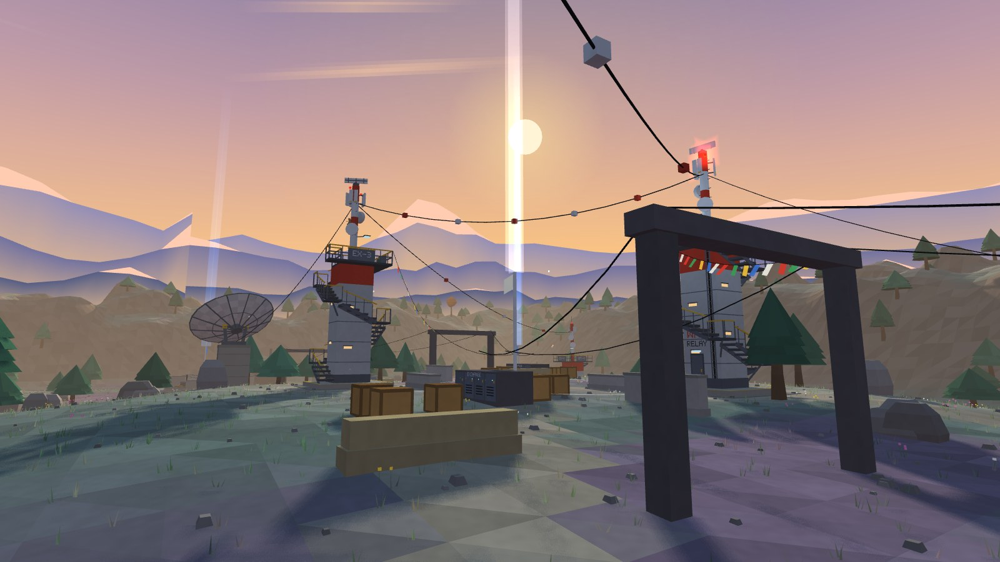

# Relay



Highland Relay 5 is a listening station on a windy plateau, seen on a clear evening after rain. Two exchange towers stand either side of the centre point, an array tower guards each inner objective, and a great dish in each half is still listening. All four towers can be climbed, and so can BACKBONE, the great cellular mast on the north flank, by ladder.

## Battlefield

Relay uses FERRITE's 354 by 204 metre footprint, five objectives and half-turn symmetry. Like every map it was spread out by half again: the objectives, bases, array towers, dishes and cable gantries moved outward, each building keeping its place beside its objective, and the ground between now holds equipment huts, fuel tanks, survey lookouts and old walled pens. The exchange towers beside C did not move.

| Point | Position (x, z) | Character |
| --- | --- | --- |
| A | -117, 24 | Generator sheds in a walled yard |
| B | -57, -39 | Communications cabin, with the west array tower 12 m south |
| C | 0, 0 | The exchange: open switchyard between the two tall towers |
| D | 57, 39 | Mirror of B, with the east array tower |
| E | 117, -24 | Mirror of A |

## The towers

Each tower is a square service core wrapped by an open steel stair. The stair turns a quarter of the way round per flight and ends on a railed deck, with a slim antenna mast above.

| Tower | Position (x, z) | Flights | Deck height | Overlooks |
| --- | --- | --- | --- | --- |
| WA-1, west array | -58, -51 | 4 | 6 m | B and the southern lane |
| WX-2, west exchange | -9.5, 9 | 6 | 9 m | C and most of the plateau |
| EX-3, east exchange | 9.5, -9 | 6 | 9 m | C and most of the plateau |
| EA-4, east array | 58, 51 | 4 | 6 m | D and the northern lane |

- **Climbing.** Steps rise 30 cm, so a player walks up without jumping. Each flight has four steps and a corner landing. The stair is open to fire on its outer side the whole way up.
- **The deck.** It covers the core and two sides of the stair ring; the last flight and a half stay open below. Two rails run round every edge and round the stairwell.
- **Cover.** Two plate parapets, 0.9 m high and 2 m long, face the objective the tower stands beside. Rails stop a player but not a bullet. Crouch behind a parapet and you are hidden from the ground on that side only.
- **Risk.** There is one way up and one way down. There is no fall damage, so stepping off the open side is the fast exit.
- **Bots** stay on the ground and route round the towers. They will shoot at a player on a deck when they can see one.
- **Ground.** Each site is levelled, with a low apron and pad, so the first step is walkable from every side.

The towers replace the old lattice masts, which could not be climbed.


## The dishes

A 5 m concrete pedestal carries an 8.4 m dish in each half, at (-49.5, 22.5) and its mirror. The pedestal is solid cover. The reflector is entirely overhead and does not collide.

## BACKBONE, the great mast

The 67 m cellular mast that used to stand beyond the ridge is now on the field, on the north flank at (0, 84): on the centre line, so it is exactly as far from each spawn, 72 m from D and 84 m from C. It is the one landmark on Relay without a half-turn twin. Instead it is mirrored across x = 0, which swaps the two bases, and its half-turn mirror on the south flank is kept as open ground. The site is levelled, and random cover and trees are kept off both flanks.

- **Solid steel.** The four tapering legs stop players and bullets (each slanted leg is followed by short straight collision pieces), as do the concrete footings, the decks, the rails, the panels round the top deck and the BACKBONE equipment hut behind the mast. The lattice bracing leaves 2.4 m of head room above the ground and both decks, so what you walk through is open lattice and what stops you is a leg.
- **Two ladders.** The first climbs the face toward the battlefield, inside a safety cage, to a rest platform at 20 m. The second starts on the far side of the platform's core and climbs to the top deck at 36.75 m, inside the first ring of panels. A service ladder carries on up the mast out of reach.
- **The rest platform** is 7.2 m square and caged: a 1.1 m plate parapet in the middle of each side (cover for a crouching player), rails elsewhere.
- **The top deck** is 5.2 m square with rails only. The six panels round it stop bullets but leave gaps; there is no parapet.
- **Risk.** It takes about 12 seconds to climb to the top, and on a ladder you cannot shoot, throw or melee, with your back to the field. Falling down a hatch is the fast way off, and there is no fall damage.

### Climbing

- Look at the rungs and push **forward** to take hold, then forward climbs (3 m/s) and **back** climbs down. Let go of the keys and you hang where you are.
- **Crouch** slides down fast (8 m/s). **Jump** lets go: you push gently back off the rungs and drop.
- At the top you step forward off the rungs onto the deck. To go down, walk backwards into the hatch while facing the rungs: the ladder catches you.
- You reach the ground or a platform and you let go on your own. Standing at the ladder, strafing, backing away or walking at it while looking elsewhere does not lift you.
- Bots stay on the ground and route round the legs, the ladder foot and the hut.

The mast's dimensions are in `crates/shared/src/map/relay.rs` (from `BACKBONE` down), the ladder movement in `crates/shared/src/sim.rs` (`ladder_at`, `climb`), and the art in `crates/client/src/scene/special_landmarks.rs`.

## What the station tells you

Nobody is here, but somebody was a moment ago.

- **The beacons talk.** The west exchange tower's red lamps spell HELLO in Morse. When it finishes, the east tower sends the same word back. The array towers just pulse.
- **Two watch posts.** On the west exchange deck: a stool, field glasses and a flask on the parapet, the log closed with a pencil squared on top, the field radio's lamp steady. On the east: the stool kicked over, the flask on the floor, the log open face up, the radio's lamp frantic.
- **The comms cabins** by B and D have a lit window, an empty chair, and a notice: IF IT ANSWERS LOG IT.
- **On the array towers:** a spotting telescope aimed over the ridge, a turning anemometer and a windsock. An owl has taken the weather arm of the east one.
- **Moving things:** a radar head turns on each exchange mast, strings of flags snap in the wind from the exchange decks down to the cable gantries, a hawk circles, seed fluff drifts across the plateau, the switchgear lamps chatter and the generators smoke.
- **Wiring you can follow:** power runs from the generator sheds along the gantries to the exchange, and signal cable runs tower to tower and out to the dishes. Each mast's microwave drums point at the towers it can see.

## Light and land

The sun is low, so shadows are long and the towers catch gold on one side. The sky runs from gold at the horizon through rose to deep blue, with cirrus, a contrail, a pale moon and the first stars. Three snow ranges stand beyond the ridge, lit rose on the sunward side. They are easiest to see from a tower deck.

On the ground there are gravel service tracks between the buildings, swept pads under the towers and dishes, heather in drifts, and cotton grass, tormentil and thistle in the turf.

## Verification

- `crates/server/tests/relay.rs` walks a player up every stair on five seeds without jumping, pushes them at every deck edge and stairwell edge to prove the rails hold, and checks that the towers are mirrored, level-footed, clear of objectives and spawns, and can see the objective they stand beside.
- `crates/server/tests/relay_mast.rs` walks a player to the mast, climbs both ladders, steps off onto each deck and climbs back down to the ground; checks that idling, strafing or backing off at the ladder never lifts you, that the legs stop players and bullets on the ground and on the platform, that the rails hold on both decks, and that a climb is deterministic and mirrors across the mast's axis.
- The shared map tests still prove Relay is mirrored (the mast across x = 0, everything else by the half turn) and that bots can route between every base and objective.
- Renderer tests bound the static dressing, the sky and the animation, and check the Morse timing.
- The all-map bot battle soak includes Relay.

Export a view with the review tool. The camera is six comma-separated numbers, the eye then the target, and an optional fourth argument freezes the animation at that second:

```powershell
cargo run --release -p ferrite --example asset_review -- relay target/relay.png "-30,7,-20,10,14,5" 1.0
```

The tower collision is in `crates/shared/src/map/relay.rs`, and the art in `crates/client/src/scene/relay.rs`.
