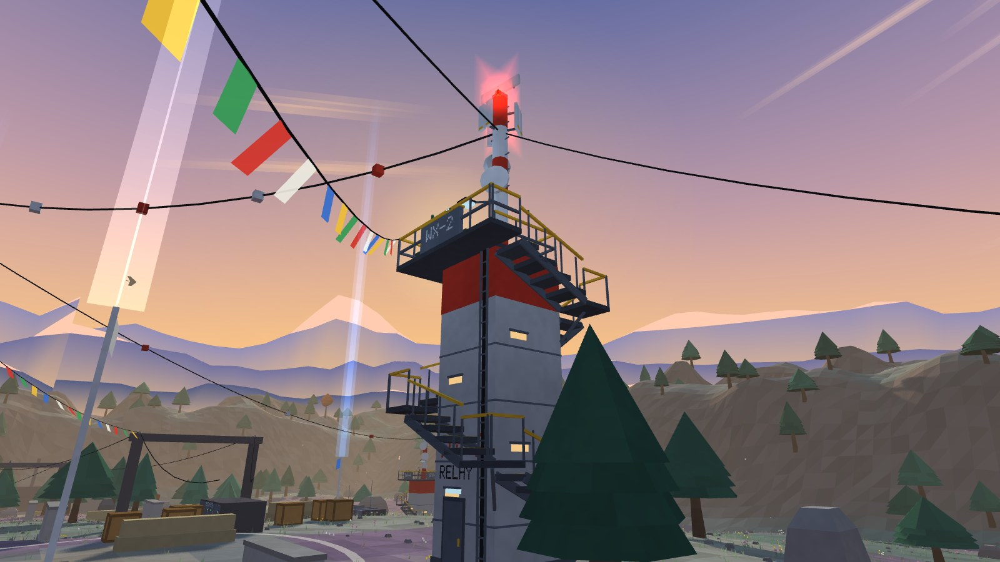

# Relay


Highland Relay 5 is a listening station on a windy plateau, seen on a clear evening after rain. Two exchange towers stand either side of the centre point, an array tower guards each inner objective, and a great dish in each half is still listening. All four towers can be climbed.

## Battlefield

Relay keeps FERRITE's 236 by 136 metre footprint, its five objectives and its half-turn symmetry. Bases, objectives and cover outside the tower sites are where they were. The random scatter of rocks, trees and lane cover has shifted slightly, because it is placed after the towers and avoids them.

| Point | Position (x, z) | Character |
| --- | --- | --- |
| A | -78, 16 | Generator sheds in a walled yard |
| B | -38, -26 | Communications cabin, with the west array tower 12 m south |
| C | 0, 0 | The exchange: open switchyard between the two tall towers |
| D | 38, 26 | Mirror of B, with the east array tower |
| E | 78, -16 | Mirror of A |

## The towers

Each tower is a square service core wrapped by an open steel stair. The stair turns a quarter of the way round per flight and ends on a railed deck, with a slim antenna mast above.

| Tower | Position (x, z) | Flights | Deck height | Overlooks |
| --- | --- | --- | --- | --- |
| WA-1, west array | -39, -38 | 4 | 6 m | B and the southern lane |
| WX-2, west exchange | -9.5, 9 | 6 | 9 m | C and most of the plateau |
| EX-3, east exchange | 9.5, -9 | 6 | 9 m | C and most of the plateau |
| EA-4, east array | 39, 38 | 4 | 6 m | D and the northern lane |

- **Climbing.** Steps rise 30 cm, so a player walks up without jumping. Each flight has four steps and a corner landing. The stair is open to fire on its outer side the whole way up.
- **The deck.** It covers the core and two sides of the stair ring; the last flight and a half stay open below. Two rails run round every edge and round the stairwell.
- **Cover.** Two plate parapets, 0.9 m high and 2 m long, face the objective the tower stands beside. Rails stop a player but not a bullet. Crouch behind a parapet and you are hidden from the ground on that side only.
- **Risk.** There is one way up and one way down. There is no fall damage, so stepping off the open side is the fast exit.
- **Bots** stay on the ground and route round the towers. They will shoot at a player on a deck when they can see one.
- **Ground.** Each site is levelled, with a low apron and pad, so the first step is walkable from every side.

The towers replace the old lattice masts, which could not be climbed. Relay's two entries in the map-geometry regression test were re-captured for this; the other maps are unchanged.



## The dishes

A 5 m concrete pedestal carries an 8.4 m dish in each half, at (-33, 15) and its mirror. The pedestal is solid cover. The reflector is entirely overhead and does not collide.

## What the station tells you

Nobody is here, but somebody was a moment ago.

- **The beacons talk.** The west exchange tower's red lamps spell HELLO in Morse. When it finishes, the east tower sends the same word back. The array towers just pulse.
- **Two watch posts.** On the west exchange deck: a stool, field glasses and a flask on the parapet, the log closed with a pencil squared on top, the field radio's lamp steady. On the east: the stool kicked over, the flask on the floor, the log open face up, the radio's lamp frantic.
- **The comms cabins** by B and D have a lit window, an empty chair, and a notice: IF IT ANSWERS LOG IT.
- **On the array towers:** a spotting telescope aimed over the ridge, a turning anemometer and a windsock. An owl has taken the weather arm of the east one.
- **Moving things:** a radar head turns on each exchange mast, strings of flags snap in the wind from the exchange decks down to the cable gantries, a hawk circles, seed fluff drifts across the plateau, the switchgear lamps chatter and the generators smoke.
- **Wiring you can follow:** power runs from the generator sheds along the gantries to the exchange, and signal cable runs tower to tower and out to the dishes. Each mast's microwave drums point at the towers it can see.

## Light and land

The sun is low, so shadows are long and the towers catch gold on one side. The sky runs from gold at the horizon through rose to deep blue, with cirrus, a contrail, a pale moon and the first stars. Three snow ranges stand beyond the ridge, lit rose on the sunward side. They are easiest to see from a tower deck.

On the ground there are gravel service tracks between the buildings, swept pads under the towers and dishes, heather in drifts, and cotton grass, tormentil and thistle in the turf.

## Verification

- `crates/server/tests/relay.rs` walks a player up every stair on five seeds without jumping, pushes them at every deck edge and stairwell edge to prove the rails hold, and checks that the towers are mirrored, level-footed, clear of objectives and spawns, and can see the objective they stand beside.
- The shared map tests still prove Relay is mirrored and that bots can route between every base and objective.
- Renderer tests bound the static dressing, the sky and the animation, and check the Morse timing.
- The all-map bot battle soak includes Relay.

Export a view with the review tool. The camera is six comma-separated numbers, the eye then the target, and an optional fourth argument freezes the animation at that second:

```powershell
cargo run --release -p ferrite --example asset_review -- relay target/relay.png "-30,7,-20,10,14,5" 1.0
```

The tower collision is in `crates/shared/src/map/relay.rs`, and the art in `crates/client/src/scene/relay.rs`.
