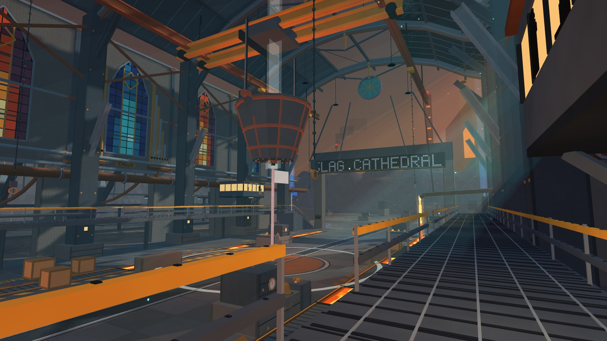
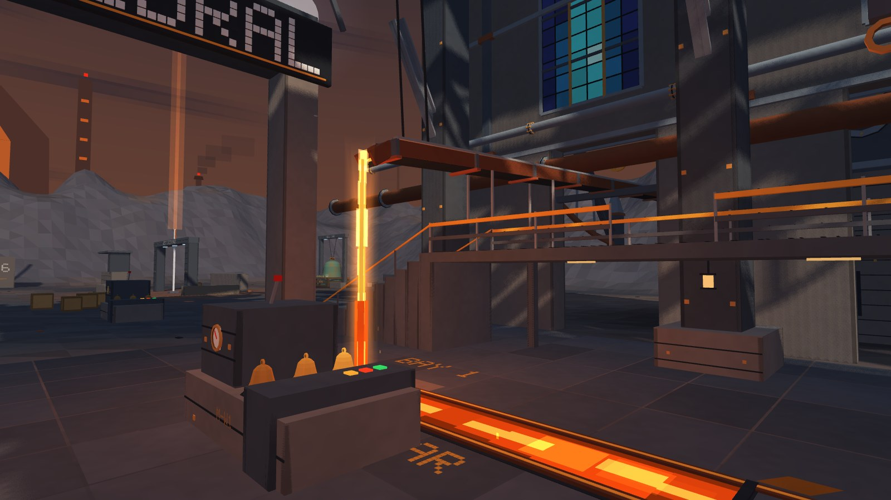
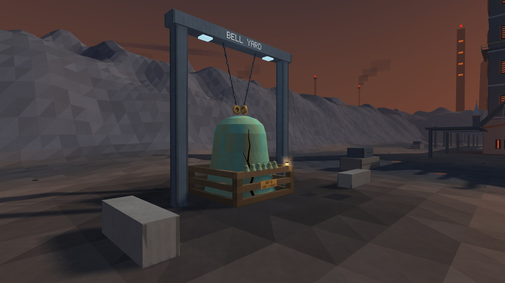

# Slag Cathedral



A vast casting works built on the scale of a cathedral. Steel ribs rise over the crucible nave, paired blast furnaces mark the skyline, and covered pipe cloisters wrap the sides. Charcoal steel, refractory masonry, scorched concrete and amber slag distinguish it from the greener battlefields.

## Battlefield

The map uses FERRITE's 354 by 204 metre combat footprint and five-point conquest rules. Its ground, hard cover, stairs and objectives are mirrored under a half-turn. Players spawn across open ground up to 20 metres from the centre of their base; each objective has an unobstructed standing core.

The cathedral itself, its galleries, furnaces and lava stand where they were first built. When the maps were spread out by half again, the stockyards, boiler courts, bell yards, pipe yards and bases moved outward with them, and the ground between was filled with ingot stores, pattern shops, open casting sheds, gas holders and slag-heap lookouts.

| Point | Sector | Position (x, z) | Character |
| --- | --- | --- | --- |
| A | West Stockyard | -117, -27 | Open industrial gateway, mould beds and staging cover |
| B | Boiler Court | -60, 33 | Sheltered courtyard and access to the nave's side routes |
| C | Crucible Nave | 0, 0 | Main casting floor beneath a suspended crucible and crane |
| D | Boiler Court | 60, -33 | Opposing courtyard, mirrored for equal approaches |
| E | East Stockyard | 117, 27 | Opposing stock gateway and approach to the base |

The central hall spans 68 by 44 metres. Six pairs of piers support 24 metre eaves and a 30 metre ridgeline; the twin furnace towers rise to 38 metres. Wide end portals, lateral doorways and offset machinery stop the architecture becoming a single choke point.

## Routes and height

- The casting floor is the direct route, broken by presses, mould beds and low cover. The capture point remains open beneath the crane.
- Raised side galleries run along both sides of the nave at 3.6 metres. Four stairways use twelve 30 centimetre rises, so players can walk up without jumping. The ground aisle stays open underneath.
- Covered service passages sit beyond the nave walls, linking the boiler courts and giving cover from the upper galleries.
- Outer pipe yards offer a wider flank with overhead racks and spaced machinery. They connect back into the stockyards and courts.

Bots use the ground flow fields; elevated galleries are optional player routes.

## Lava channels



Two open lava channels run the length of the casting floor, 8.6 metres either side of the centre line and 1.3 metres wide. Each is molten in four stretches and bridged by steel grating in three places: a wide central bridge beside the capture point and one towards each end of the nave. The channels stop short of the end portals, so players can also walk around them.

Standing in the melt burns 40 health a second, for either team, and spawn protection does not help. A death there appears in the kill feed as `Lava`. A running jump clears a channel, and the bridges and banks are safe. The capture core, spawn discs and all hard cover stay clear of the lava, and the layout is mirrored under the map's half-turn like everything else.

Bots treat the molten stretches as blocked and cross on the bridges. They will not strafe or back into a channel during a firefight.

## The story the works tells

Works No. 6 cast bells. Its sixth great bell cracked as it cooled, and the seventh never left its mould. The furnaces cannot be let out, so the works still runs with nobody on shift. Everything on the map follows from that.

**The bell yards.** The two quiet corners of the map each hold a five metre bell under a lifting gantry. In the south-west stands No. 6: green with verdigris, split from lip to waist, shored in timber and still chained to the gantry that lifted it. Six failed trial casts are lined up on the cribbing, and a lantern still burns beside them. In the north-east is No. 7, clay still clinging to it, standing in a banded flask whose seams glow. One slab of the mould has fallen away to show new bronze underneath. Broken mould halves lie round the west yard and give low cover; the bells and gantry posts are solid.

**Lavafalls.** Each furnace is tapped into an open launder that runs out over the gallery and pours seven metres into a lava channel. The falls land in the long molten stretches, so they mark the hazard from across the nave.

**The choir.** Four ranks of organ pipes flank the central window on each wall, over a brass plate that reads CHOIR. They sound in puffs of steam, in a slow figure that never quite repeats.

**Glass and light.** The lancets are leaded in a flame motif, amber in one bay and aqua in the next. The evening sun comes through three north windows as slanting shafts with drifting motes, and lays pools of coloured light across the casting floor.

**The ladle railway.** One straight track runs from gate to gate through both portals, with a turntable under the crucible. It is the map's spine and the easiest way to find the centre. The crucible itself drips: a bead gathers, falls and bursts on the turntable every few seconds.

**Outside.** Lattice flying buttresses carry the clerestory down to pinnacles on the cloister roofs. Guy cables with warning markers run from the furnace crowns to the ridge, the shafts carry catwalks, caged ladders and red beacons, and each stack burns a flare. Yard floods are cold white against the furnace orange. The ground is stained by what happened on it: soot round the furnaces, ore dust in the stockyards, pale flux in the boiler courts, black sand in the bell yards. Puddles hold the colour of the sky.

**The sky.** A smoke-reddened sun, a veiled moon and the first stars sit behind long bands of kiln smoke. Beyond the ridge stand the stacks of other works, each with a red lamp. On the nave's axis, at both ends, a sister cathedral shows a lit window through the far portal.



### Things to find

- The works cat, asleep on a warm control pedestal beside the hot bells. It also sits in a cabin window.
- Shift C's board on the outside of the north wall: eight hooks, seven helmets, and four lamps kept lit on the shelf.
- "Days without incident: 000", beside each portal.
- A chalk tally of pours on a pier, with a doodle of a cracked bell.
- Somebody's dinner on the north gallery, and a nest with three eggs in a roof brace.
- Two lit control cabins above the galleries, a coat and hat still on the hook.
- Birds circling the open ridge lantern.

### How it is built

Anything a player can touch is flush with the floor, well overhead, or skinned onto collision read from the shared layout, so the dressing never changes how the map plays. The bell yards and the buildings between the yards are the only collision added since the map was first built; they are mirrored like everything else. The art pass lives in `crates/client/src/scene/slag_cathedral_art.rs`.

The five sector names appear in the capture prompt. The map is available through the host selector, map vote, rotation, and `--map "slag cathedral"` (`--map slag` also works).

## Music

The supplied **Slag Cathedral** score is embedded for this battlefield. Its 2:34 runtime is preserved in a stereo Vorbis asset and it loops with the existing music fades. It plays in Slag Cathedral's lobby; enable music during matches to hear it during the round. The master music switch and volume remain in effect. Other maps retain their existing music selection.

## Verification

A fingerprint test pins the layout of all seven maps. Slag-specific tests exercise deterministic collision, half-turn symmetry, spawn and capture clearance, ground flow paths across five seeds, physical base-to-nave movement, all four stairways and gallery crossings, and the lava channels: mirrored spans, safe bridges, clear pads and cover, and a burn that kills and is reported as lava. The bell yards are checked for mirroring, pad clearance and walkable gaps under both gantries. Renderer tests bound the static, animated and sky meshes. The existing all-map bot battle soak includes Slag Cathedral.

Preview images are exported from FERRITE's renderer, without a desktop capture session.


Export a reproducible renderer view with the existing review tool:

```powershell
cargo run --release -p ferrite --example asset_review -- slag target/slag-nave.png nave
```

Other views are `overview`, `gallery`, `furnace` and `approach`. A view can also be six comma-separated numbers, the eye then the target (`-94,3.2,-33,-83,3,-44` frames bell No. 6), and an optional fourth argument freezes the animation at that second. This exporter does not connect to a server or read player settings.
